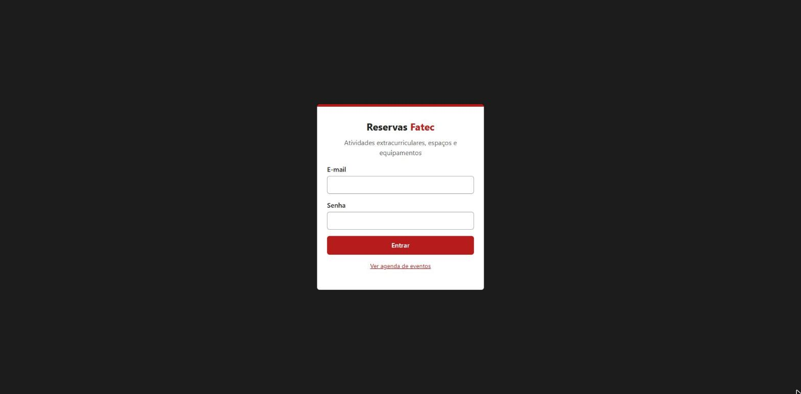
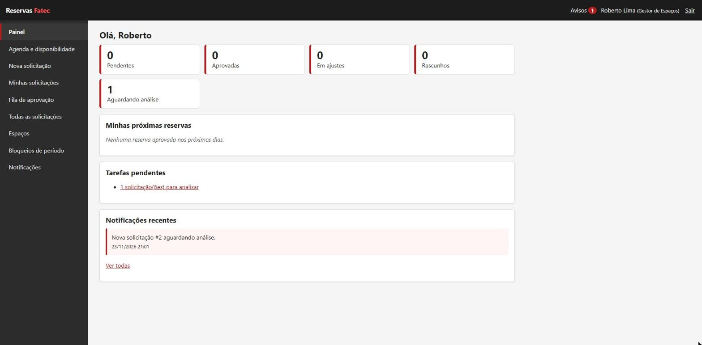
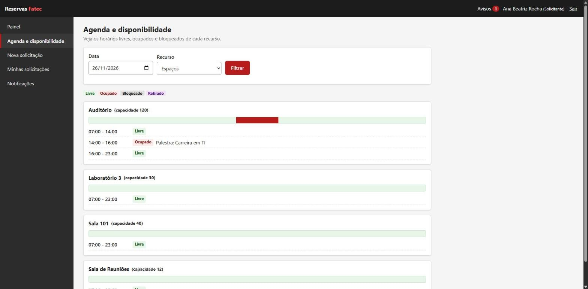
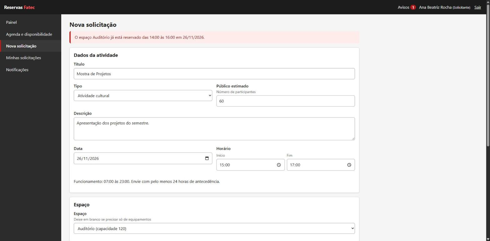
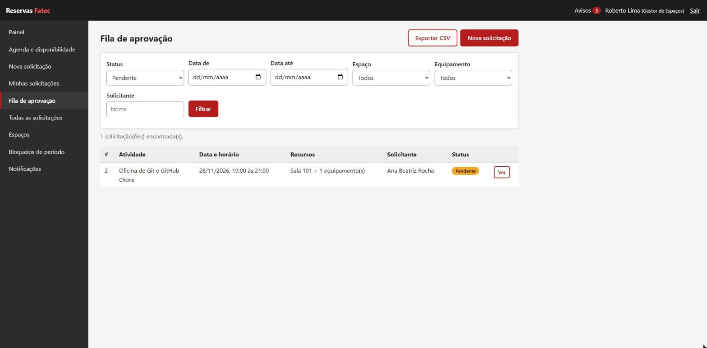
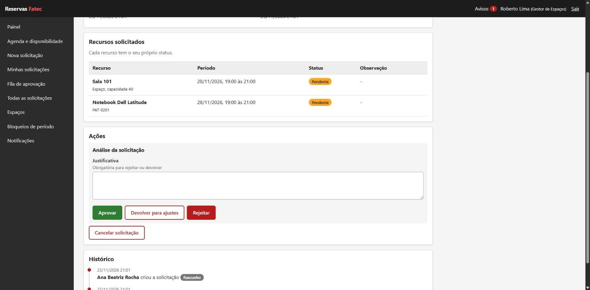
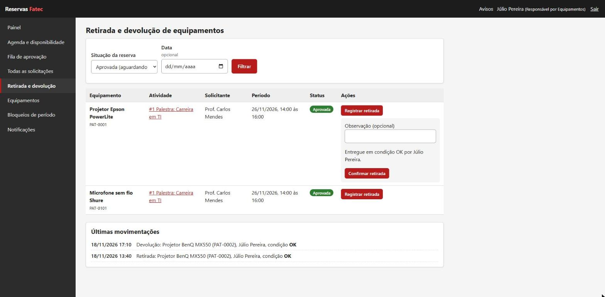
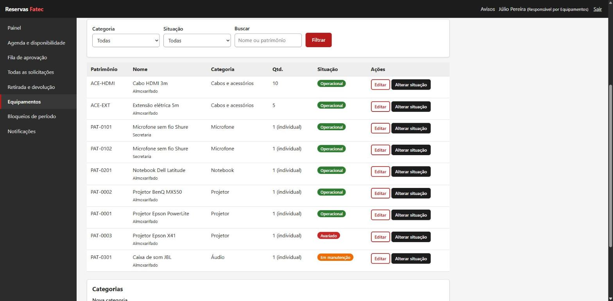
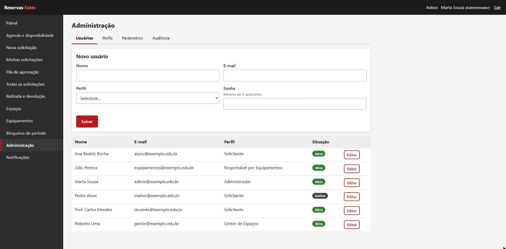
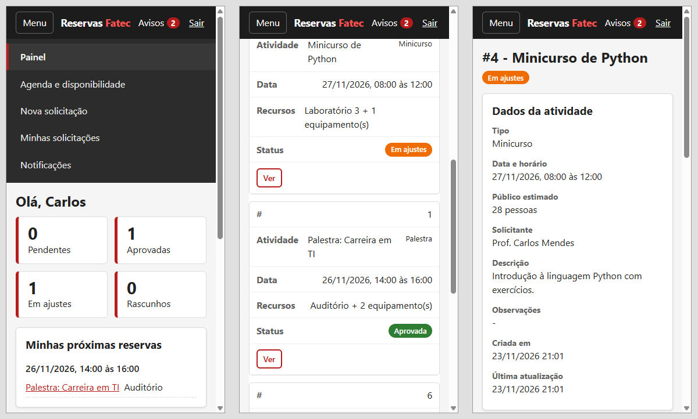

# Reservas Fatec

Sistema web de gestão de atividades extracurriculares e reservas de espaços e equipamentos.

Trabalho de equivalência de estágio - Fatec.
Autor: Daniel Rodrigues Lopes Adejarbas

## Sobre o projeto

Na faculdade acontecem palestras, oficinas, minicursos, reuniões de projeto e outros eventos que precisam de um espaço (auditório, sala, laboratório) e às vezes de equipamentos (projetor, microfone, notebook). Quando esses pedidos chegam por e-mail, conversa ou papel, fica difícil saber o que está livre, evitar dois eventos no mesmo lugar e saber quem autorizou o quê.

O sistema centraliza esse processo:

- o solicitante consulta a disponibilidade e faz o pedido;
- a secretaria aprova, rejeita ou devolve para ajustes;
- o responsável por equipamentos autoriza os itens e registra a retirada e a devolução;
- tudo fica registrado no histórico.

A ideia foi seguir a orientação do enunciado: **um sistema pequeno, completo e confiável**. As regras importantes (conflito de horário, capacidade, permissões, aprovação sem duplicar recurso) estão no servidor e cobertas por testes.

## Documentação do trabalho

| Entregável | Onde está |
|---|---|
| Regras de negócio, RF/RNF implementados e limitações conhecidas | [docs/regras-de-negocio.md](docs/regras-de-negocio.md) |
| Modelagem: DER, casos de uso, estados e processo (Mermaid) | [docs/modelagem.md](docs/modelagem.md) |
| Protótipo das telas e paleta de cores | [docs/wireframes.md](docs/wireframes.md) |
| Roteiro de demonstração | [docs/roteiro-demonstracao.md](docs/roteiro-demonstracao.md) |
| Evidência de execução dos testes | [docs/evidencias/saida-testes.txt](docs/evidencias/saida-testes.txt) |
| Script de criação do banco | [backend/database/schema.sql](backend/database/schema.sql) |
| Dados fictícios (seed) | [backend/database/seed.js](backend/database/seed.js) |
| Testes automatizados | [backend/tests/](backend/tests/) |
| Exemplos de chamadas à API | [backend/api.http](backend/api.http) |

## Funcionalidades

- Login com perfis: Solicitante, Gestor de Espaços, Responsável por Equipamentos e Administrador
- Permissões verificadas no servidor em todas as rotas (403 para quem não pode)
- Cadastro de espaços (com capacidade), equipamentos (patrimônio, categoria, situação) e categorias
- Agenda por dia mostrando horários livres, ocupados e bloqueados
- Solicitação de espaço e equipamentos, com rascunho
- Verificação de conflito, capacidade, bloqueios, horário de funcionamento e antecedência
- Análise: aprovar, rejeitar (com justificativa) e devolver para ajustes, com status próprio para cada recurso
- Cancelamento que libera a agenda
- Retirada e devolução de equipamentos com condição. Devolução com avaria deixa o item indisponível
- Bloqueio de períodos
- Notificações dentro do sistema
- Histórico de cada solicitação e auditoria das ações administrativas
- Listagens com filtros (status, data, espaço, equipamento, solicitante) e exportação em CSV
- Agenda pública só com os eventos aprovados (opcional do enunciado)
- Layout responsivo (celular e desktop) e navegação por teclado

## Telas

**Login**


**Painel do gestor**


**Agenda e disponibilidade por dia**


**Conflito de horário bloqueado com mensagem clara**


**Fila de aprovação e exportação CSV**


**Análise da solicitação, com status por recurso**


**Retirada e devolução de equipamentos**


**Cadastro de equipamentos com situação**


**Administração**


**Versão para celular**


## Tecnologias

| Parte | Tecnologia |
|---|---|
| Backend | Node.js + Express (API REST em `/api`) |
| Banco | SQLite com `better-sqlite3` |
| Autenticação | JWT em cookie `httpOnly`, senhas com `bcryptjs` |
| Frontend | HTML, CSS e JavaScript puro, servidos pelo próprio Express |
| Testes | Test runner nativo do Node (`node:test`) + `supertest` |

## Pré-requisitos

- Node.js 22 ou mais novo (o `better-sqlite3` usado exige essa versão)
- npm

## Como rodar

```bash
cd backend
npm install
cp .env.example .env      # no Windows (cmd): copy .env.example .env
npm run seed              # cria o banco e os dados de exemplo
npm start
```

Acesse **http://localhost:3000**.

- `npm run seed` apaga e recria o banco. Use sempre que quiser voltar aos dados iniciais.
- Para desenvolvimento, `npm run dev` reinicia o servidor quando um arquivo é salvo.
- Se o `.env` não for criado, o servidor sobe mesmo assim com uma chave de desenvolvimento (e avisa no terminal).

### Problemas comuns

- **Erro do `node-gyp` / "Visual Studio" no `npm install`**: confira se está rodando dentro da pasta `backend` (é lá que fica o arquivo `.npmrc` que evita essa compilação) e se o Node é 22 ou mais novo (`node -v`).
- **Porta 3000 ocupada**: mude `PORT` no `.env`.

## Usuários de teste

A senha de todos é **`senha123`**.

| Perfil | E-mail | O que pode fazer |
|---|---|---|
| Administrador | admin@exemplo.edu.br | Tudo, incluindo usuários, perfis, parâmetros e auditoria |
| Gestor de Espaços | gestor@exemplo.edu.br | Analisa solicitações, cadastra espaços, bloqueia períodos |
| Resp. por Equipamentos | equipamentos@exemplo.edu.br | Cadastra equipamentos, aprova itens, registra retirada e devolução |
| Solicitante (docente) | docente@exemplo.edu.br | Cria e acompanha as próprias solicitações |
| Solicitante (aluna) | aluno@exemplo.edu.br | Cria e acompanha as próprias solicitações |
| Usuário inativo | inativo@exemplo.edu.br | Não consegue entrar (para testar) |

O seed também cria espaços, equipamentos (inclusive um em manutenção e um avariado), bloqueios e uma solicitação em cada status.

## Testes

```bash
cd backend
npm test
```

Para gerar o arquivo de evidência em `docs/evidencias/saida-testes.txt`:

```bash
npm run test:evidencia
```

Os testes usam um banco em memória, então não mexem no banco da aplicação.

| Critério de aceite | Teste |
|---|---|
| CA-01: sobreposição no mesmo espaço é bloqueada (inclusive parcial) | `tests/conflito.test.js` |
| CA-02: reserva encostada é permitida | `tests/conflito.test.js` |
| CA-03: público acima da capacidade é bloqueado | `tests/regras.test.js` |
| CA-04: equipamento em manutenção não pode ser reservado | `tests/regras.test.js` |
| Usuário sem permissão recebe 403 | `tests/permissoes.test.js` |
| Dados obrigatórios ausentes | `tests/regras.test.js` |
| CA-07: rejeição sem justificativa é bloqueada | `tests/aprovacao.test.js` |
| CA-08: alterar reserva aprovada revalida e volta para análise | `tests/aprovacao.test.js` |
| CA-09: cancelamento libera o horário | `tests/aprovacao.test.js` |
| CA-10: retirada registra responsável e horário | `tests/movimentacao.test.js` |
| CA-11: devolução com avaria deixa o equipamento indisponível | `tests/movimentacao.test.js` |
| CA-12: duas aprovações simultâneas não duplicam a alocação | `tests/aprovacao.test.js` |
| Fluxo completo (solicitar, ajustar, aprovar, retirar, devolver) | `tests/movimentacao.test.js` |

## Estrutura de pastas

```
.
├── backend/
│   ├── database/
│   │   ├── schema.sql          criação das tabelas
│   │   └── seed.js             dados de exemplo
│   ├── src/
│   │   ├── server.js           inicia o servidor
│   │   ├── app.js              configuração do Express
│   │   ├── db.js               conexão com o SQLite
│   │   ├── routes/             rotas da API e permissões de cada uma
│   │   ├── controllers/        recebem a requisição e devolvem a resposta
│   │   ├── services/           regras de negócio
│   │   ├── models/             consultas SQL
│   │   ├── middlewares/        autenticação, permissão e tratamento de erros
│   │   └── utils/              datas, validação, erros
│   ├── tests/                  testes automatizados
│   ├── api.http                requisições de exemplo (extensão REST Client)
│   ├── .npmrc                  evita compilar o better-sqlite3 na instalação
│   └── .env.example
├── frontend/
│   ├── *.html                  uma página por tela
│   ├── css/style.css
│   └── js/                     um script por tela + api.js, layout.js, util.js
└── docs/
    ├── regras-de-negocio.md    regras -> onde estão no código, RF/RNF
    ├── modelagem.md            DER, casos de uso, estados e processo (Mermaid)
    ├── wireframes.md           protótipo das telas e paleta de cores
    ├── roteiro-demonstracao.md passo a passo da apresentação
    ├── prints/                 imagens das telas usadas neste README
    └── evidencias/
        └── saida-testes.txt    saída dos testes
```

A requisição segue o caminho `rota → middleware (login/permissão) → controller → service (regras) → model (SQL)`.

## Principais endpoints

| Método e rota | Função |
|---|---|
| `POST /api/auth/login` / `POST /api/auth/logout` / `GET /api/auth/me` | Login, logout, usuário logado |
| `GET /api/disponibilidade?data=&tipo=` | Agenda do dia por espaço ou equipamento |
| `GET /api/disponibilidade/verificar` | Verifica se um recurso está livre no período |
| `GET /api/agenda?de=&ate=` | Agenda pública (só eventos aprovados) |
| `GET/POST/PUT /api/espacos` | Espaços |
| `GET/POST/PUT /api/equipamentos`, `PATCH /api/equipamentos/:id/situacao` | Equipamentos e avaria/manutenção |
| `GET/POST/PUT /api/categorias` | Categorias |
| `GET/POST/DELETE /api/bloqueios` | Bloqueios de período |
| `GET/POST /api/solicitacoes`, `GET/PUT /api/solicitacoes/:id` | Solicitações (a atividade é criada junto) |
| `PATCH /api/solicitacoes/:id/enviar`, `/aprovar`, `/rejeitar`, `/devolver`, `/cancelar`, `/concluir` | Mudanças de status |
| `GET /api/reservas-equipamento`, `PATCH /api/reservas-equipamento/:id/aprovar`, `/rejeitar` | Decisão por equipamento |
| `GET/POST /api/movimentacoes` | Retirada e devolução |
| `GET /api/notificacoes`, `PATCH /api/notificacoes/:id/lida`, `PATCH /api/notificacoes/lidas` | Notificações |
| `GET/POST/PUT /api/usuarios`, `GET/PUT /api/perfis`, `GET/PUT /api/parametros`, `GET /api/auditoria` | Administração |

O arquivo `backend/api.http` tem exemplos prontos para testar no VS Code.

## Decisões de projeto

- **Disponibilidade é calculada, não guardada.** Não existe campo "disponível": o sistema olha as reservas aprovadas e os bloqueios do período.
- **Pendente não bloqueia a agenda.** Só reserva aprovada ocupa o horário. Mesmo assim, o envio já é recusado se bater com algo aprovado, e a aprovação verifica tudo de novo dentro de uma transação (`BEGIN IMMEDIATE`).
- **A atividade é cadastrada junto com a solicitação**, no mesmo formulário. Toda solicitação tem uma atividade; para um empréstimo avulso de equipamento, usa-se o tipo "Outro".
- **Permissões por ação**: cada perfil tem uma lista de permissões (ex.: `decidir_espaco`), e o administrador pode alterar essa lista.
- **Nada importante é apagado**: usuários são desativados e o histórico é protegido por trigger no banco.

Mais detalhes e limitações conhecidas em [docs/regras-de-negocio.md](docs/regras-de-negocio.md).
