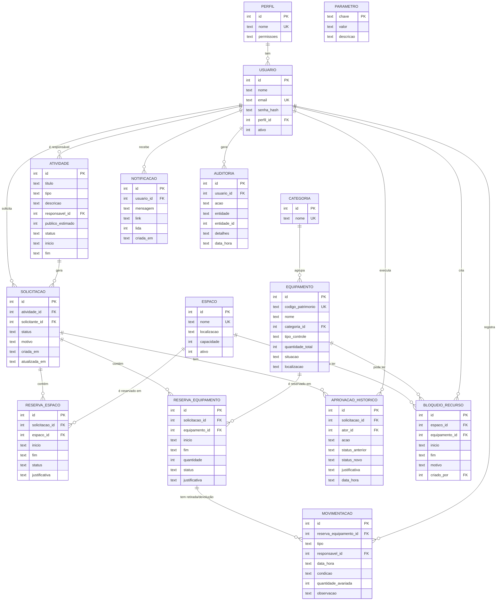
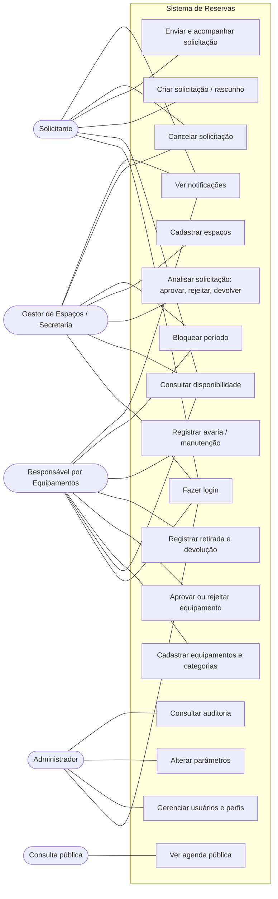
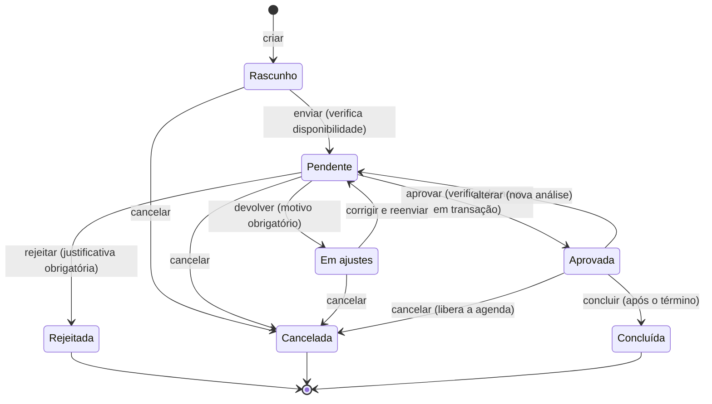
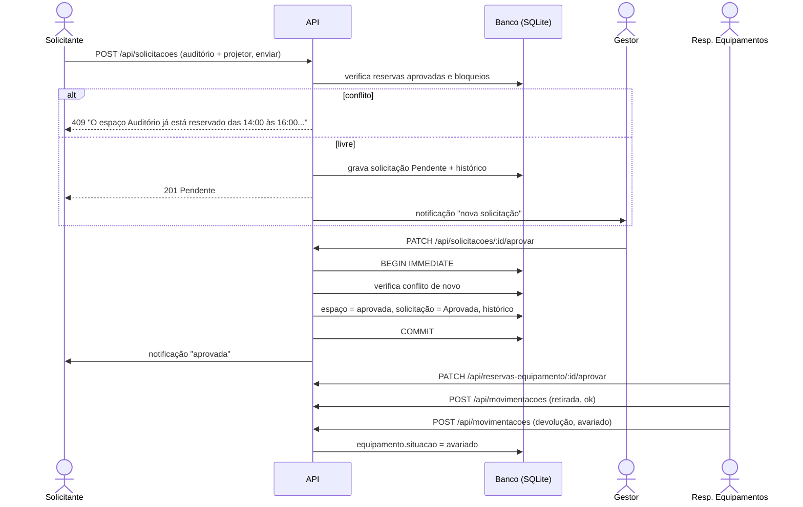

# Modelagem

Os diagramas estão em Mermaid. O GitHub mostra eles direto no navegador; no VS Code dá para ver com a extensão "Markdown Preview Mermaid Support".

## DER (Diagrama Entidade-Relacionamento)

Observações sobre o modelo:

- **Disponibilidade não é guardada.** Ela é calculada a partir de `RESERVA_ESPACO` / `RESERVA_EQUIPAMENTO` (status `aprovada` ou `retirado`) e `BLOQUEIO_RECURSO`.
- `BLOQUEIO_RECURSO` tem `espaco_id` **ou** `equipamento_id`, nunca os dois (`CHECK` no banco). O PDF sugere `tipo_recurso + recurso_id`; separando em duas colunas dá para ter chave estrangeira.
- `EQUIPAMENTO.tipo_controle` separa o item individual (patrimônio, quantidade 1) do item por quantidade (estoque, ex.: cabos).
- `MOVIMENTACAO` tem `UNIQUE (reserva_equipamento_id, tipo)`: no máximo uma retirada e uma devolução por reserva.
- `APROVACAO_HISTORICO` tem triggers que impedem `UPDATE` e `DELETE`.
- `PARAMETRO` guarda as regras configuráveis (intervalo técnico, horário de funcionamento, antecedência).

## Diagrama de casos de uso

## Diagrama de estados da solicitação

## Processo: reserva de auditório com equipamento

